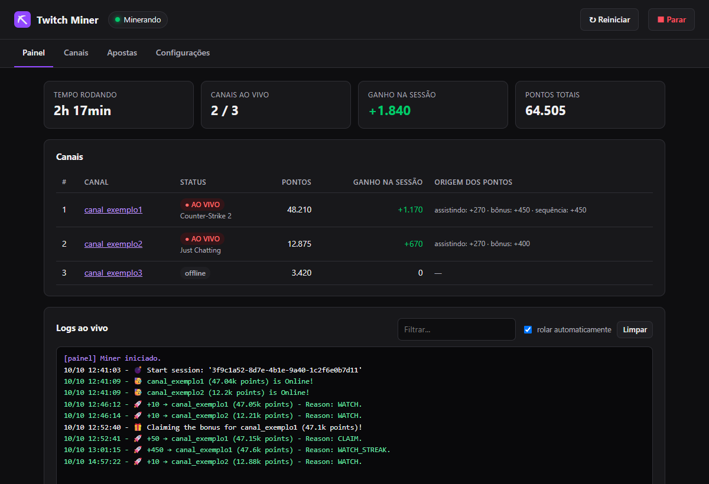
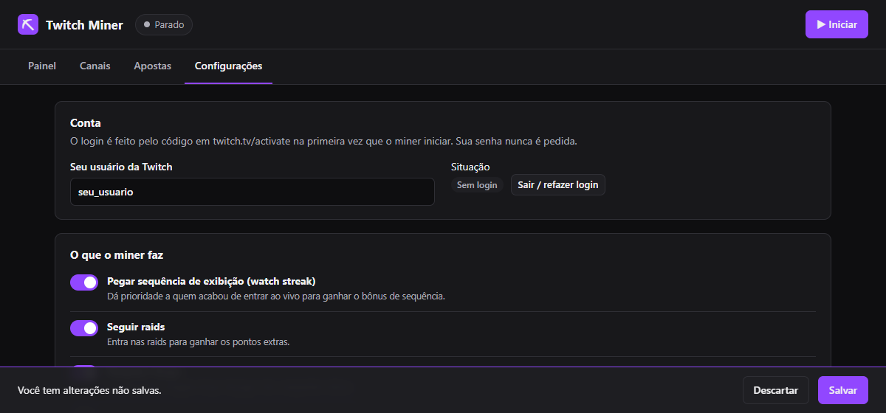
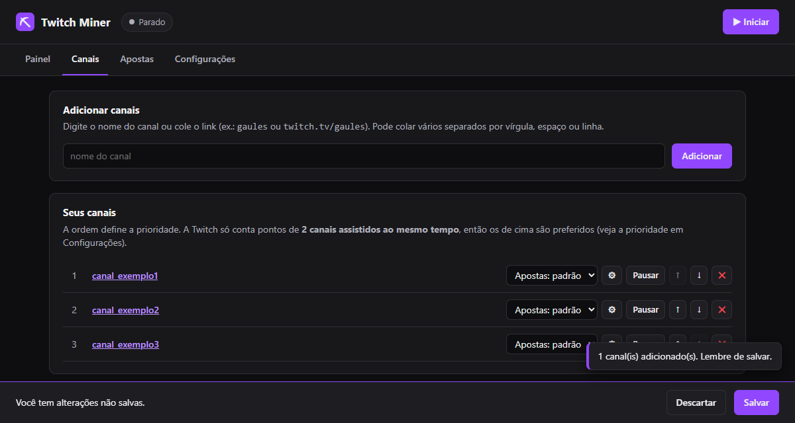
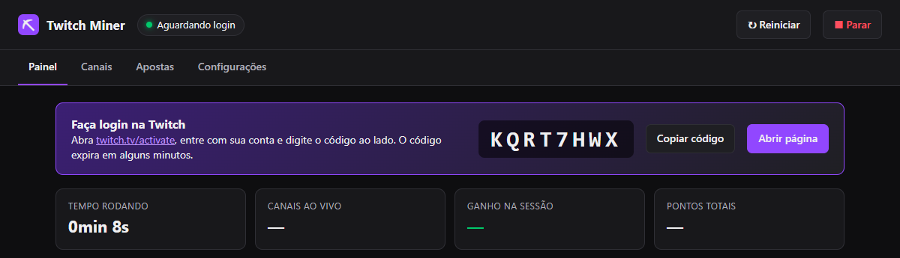

# ⛏ Twitch Miner com Painel

Ganhe **pontos de canal da Twitch** automaticamente nos seus canais favoritos, sem precisar deixar a live aberta. Tudo é controlado por um **painel simples no navegador**, em português e sem mexer em código.

  
   
  Windows 10 ou 11 (64 bits) · Grátis · Não precisa instalar nada antes

---

## 🚀 Como começar (uns 5 minutos)

### 1. Baixe e extraia

Clique no botão **Baixar para Windows** acima. Vai ser baixado um arquivo `.zip`.

Abra a pasta **Downloads**, clique com o **botão direito** no arquivo e escolha **Extrair tudo...**. Escolha um lugar fixo, como a pasta **Documentos**, e clique em **Extrair**.

> [!WARNING]
> Não abra o programa direto de dentro do `.zip`: extraia antes.

### 2. Instale com dois cliques

Dentro da pasta extraída, dê **dois cliques em `Instalar.bat`**. Uma janela preta vai aparecer e instalar tudo sozinha. Espere ela terminar, o que leva alguns minutos. No final, o painel abre no seu navegador.

> [!IMPORTANT]
> Se aparecer a tela azul **"O Windows protegeu o computador"**, clique em **Mais informações** e depois em **Executar assim mesmo**. Esse aviso aparece em qualquer programa baixado da internet que não seja de uma grande empresa.

### 3. Informe seu usuário da Twitch

No painel, abra a aba **Configurações**, digite o seu **nome de usuário da Twitch** e clique em **Salvar**, lá embaixo.

> [!NOTE]
> O programa **nunca pede sua senha**. O login é feito no site oficial da Twitch (passo 5).

### 4. Adicione os canais

Abra a aba **Canais**, digite o nome do canal (ou cole o link, como `twitch.tv/nome_do_canal`) e clique em **Adicionar**. Repita para cada canal e, no final, clique em **Salvar**.

> [!TIP]
> A Twitch só conta pontos de **2 canais ao mesmo tempo**. Se mais de 2 estiverem ao vivo, o programa dá preferência aos de cima da lista. Use as setas ↑ ↓ para reordenar.

### 5. Clique em Iniciar e faça o login

Clique no botão roxo **▶ Iniciar**, no canto de cima. Na primeira vez, vai aparecer um **código**:

1. Clique em **Abrir página**. O site [twitch.tv/activate](https://www.twitch.tv/activate) vai abrir.
2. Entre na sua conta da Twitch, se pedir.
3. Digite o código que aparece no painel e confirme.

Pronto! O aviso some sozinho em alguns segundos e o programa começa a minerar. Esse login só é feito **uma vez**.

### 6. Acompanhe seus pontos 🎉

Na aba **Painel** você vê quais canais estão ao vivo, quantos pontos ganhou e o que o programa está fazendo, tudo em tempo real. Pode fechar a aba do navegador: o programa **continua minerando** em segundo plano.

---

## 📅 No dia a dia

| Quero... | Como fazer |
|---|---|
| **Abrir o painel de novo** | Dê dois cliques no atalho **Twitch Miner** da Área de Trabalho ou clique no ícone **⛏ perto do relógio** do Windows. Não precisa decorar nenhum endereço. |
| **Minerar sempre que ligar o PC** | **Configurações → Iniciar com o Windows**. |
| **Parar de minerar** | Botão **■ Parar** no painel. Para fechar tudo, clique com o botão direito no ícone ⛏ e escolha **Encerrar Twitch Miner**. |
| **Apostar pontos automaticamente** | Aba **Apostas** (desligado por padrão; apostar pode fazer você perder pontos). |
| **Atualizar o programa** | É automático: o painel verifica a cada 6 horas e avisa na tela inicial com o botão **Atualizar agora**. |

> [!NOTE]
> O computador precisa estar **ligado e com internet** para o programa ganhar pontos.

---

## ❓ Problemas comuns

<b>Não acho o ícone ⛏ perto do relógio</b>

O Windows costuma esconder ícones novos. Clique na **setinha ^** ao lado do relógio: ele deve estar lá. Se quiser, arraste-o para a barra de tarefas para ele ficar sempre visível.

<b>Deu erro na instalação</b>

Verifique sua internet e dê dois cliques no `Instalar.bat` de novo: ele continua de onde parou e repara o que estiver faltando. Se o erro continuar, tire um print da janela e [abra uma issue](https://github.com/alexsandrejr/Twitch-Channel-Points-Miner-v2/issues).

<b>Mudei a pasta do programa de lugar e o atalho parou de funcionar</b>

Rode o `Instalar.bat` de novo, a partir da pasta nova. Ele refaz os atalhos. Se você usa **Iniciar com o Windows**, desative e ative essa opção de novo nas Configurações.

<b>Quero entrar com outra conta da Twitch</b>

Pare o programa, vá em **Configurações → Sair / refazer login**, troque o usuário, salve e clique em **Iniciar**. Um novo código vai aparecer.

<b>Como desinstalar?</b>

1. Desative **Iniciar com o Windows** nas Configurações e encerre o programa pelo ícone ⛏.
2. Apague a pasta do programa e o atalho da Área de Trabalho.
3. (Opcional) Apague a pasta `%LOCALAPPDATA%\TwitchMinerPainel`. Cole esse endereço na barra do Explorador de Arquivos para chegar nela.

---

## Créditos e licença

Todo o trabalho do miner é do projeto original [rdavydov/Twitch-Channel-Points-Miner-v2](https://github.com/rdavydov/Twitch-Channel-Points-Miner-v2), que recebe as correções todo dia neste fork. Para a documentação técnica completa, veja o [README original](../README.md). Distribuído sob a licença [GPL-3.0](../LICENSE).

Uso por sua conta e risco: automatizar a Twitch pode ir contra os termos de uso da plataforma.
